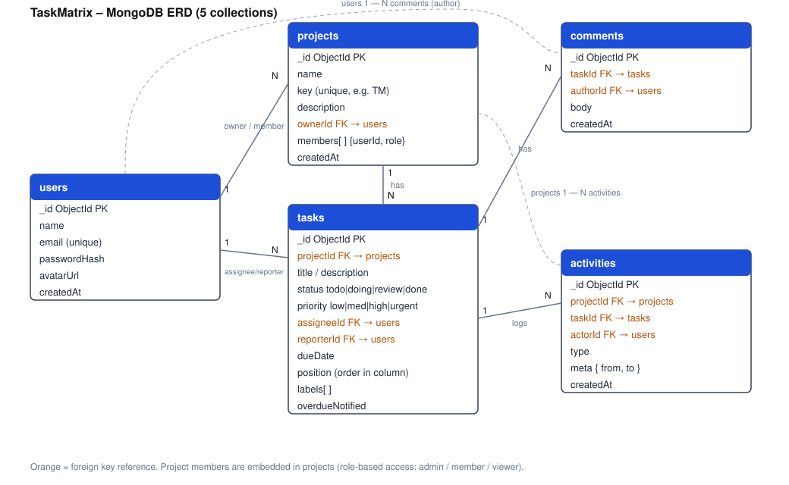

# TaskMatrix – Agile Project Management Platform

> A Jira/Asana-style tool for software teams: Kanban boards, task assignment, deadline reminders, role-based access and a real-time activity feed.

**Sprint 13 – Capstone Blueprint (PRD)** · RFP option 3 · scope locked on submission

| | |
|---|---|
| **Designated track** | Fullstack |
| **Author** | _Your name_ · Employee ID _XXXX_ |
| **Figma wireframes** | _paste public link here_ |
| **Demo video** | _paste link here_ |

## 1. Problem & vision
Small software teams lose time to scattered to-do lists and unclear ownership. TaskMatrix gives a team one shared board where every task has an owner, a priority and a deadline, and where everyone sees changes as they happen.

## 2. Users and roles (RBAC)
| Role | Can do |
|---|---|
| **Admin** (project owner) | Everything: manage members and roles, edit/delete project, delete any task |
| **Member** | Create/edit tasks, move cards, assign, comment |
| **Viewer** | Read-only board, tasks, comments and feed |

## 3. Tech stack
| Layer | Choice |
|---|---|
| Frontend | Next.js (App Router), React, TypeScript |
| Styling / UI | Tailwind CSS + shadcn/ui |
| Client state | Zustand (UI) + TanStack Query (server data) |
| Drag and drop | dnd-kit |
| Backend | Node.js, Express |
| Database | MongoDB + Mongoose (MongoDB Atlas) |
| Auth | JWT (access + refresh), bcrypt, role middleware |
| Real time | Socket.io |
| Scheduled jobs | node-cron |
| Validation | Zod |
| Deploy (Sprint 17) | Vercel (web), Render (API), GitHub Actions CI/CD |

## 4. Core features (prioritized)
**P0 – MVP (Sprint 14)**
1. Sign up / log in / log out with JWT
2. Create projects, invite members, assign roles
3. Task CRUD with title, description, priority, assignee, due date
4. Kanban board with 4 columns (To do, In progress, In review, Done)
5. Drag-and-drop between columns and reordering, persisted

**P1 – Full features (Sprint 15)**
6. Role-based permissions enforced on API and hidden in UI
7. Priority tags (low, medium, high, urgent), labels, filters by assignee/priority
8. Task details drawer with comments
9. Real-time activity feed per project (Socket.io)
10. Deadline cron job: daily check, flags overdue tasks and notifies assignee in-app

**P2 – Polish (Sprints 16–17)**
11. Fully responsive mobile board
12. AI helper: summarize a task thread / suggest subtasks
13. Dark mode, empty/error/loading states
14. CI/CD and go-live

**Out of scope (to avoid scope creep):** video calls, payments, time tracking, file storage, social feeds, third-party integrations.

## 5. Screens (see `docs/wireframes.html`)
1. Auth (log in / sign up)
2. Projects dashboard
3. Kanban board + activity feed
4. Task details drawer
5. Mobile board and navigation drawer

Routing: `/login`, `/signup`, `/dashboard`, `/projects/[id]` (board), `/projects/[id]/tasks/[taskId]` (drawer), `/projects/[id]/settings` (members, roles), `/my-tasks`.

## 6. System architecture

### ERD (5 collections)


Source: [`docs/schema.dbml`](docs/schema.dbml) (open in dbdiagram.io).

**Design decisions**
- `members` is embedded in `projects` because membership is always read with the project and is small.
- `tasks` is its own collection (large, queried and updated independently), indexed on `{projectId, status, position}`.
- `activities` is append-only and feeds the live feed and audit trail.
- `comments` is separate so threads can grow without bloating tasks.

### REST API
| Method | Endpoint | Min. role |
|---|---|---|
| POST | `/api/auth/signup`, `/api/auth/login`, `/api/auth/refresh` | public |
| GET/POST | `/api/projects` | member |
| GET/PATCH/DELETE | `/api/projects/:id` | member / admin / admin |
| POST/PATCH/DELETE | `/api/projects/:id/members` | admin |
| GET/POST | `/api/projects/:id/tasks` | viewer / member |
| PATCH | `/api/tasks/:id` (edit, move, assign) | member |
| DELETE | `/api/tasks/:id` | admin |
| GET/POST | `/api/tasks/:id/comments` | viewer / member |
| GET | `/api/projects/:id/activity` | viewer |

**Socket events:** `task:created`, `task:moved`, `task:updated`, `comment:added`, joined per room `project:{id}`.

### Request flow
Browser → Next.js UI → Express API (auth + role middleware + Zod) → MongoDB → write `activities` doc → Socket.io broadcast → other clients update.

## 7. Non-functional requirements
- Responsive from 360px to desktop
- API responses under 300 ms for board load (up to 200 tasks)
- Passwords hashed, input validated, rate limit on auth routes
- Keyboard-accessible drag and drop (dnd-kit sensors)

## 8. Roadmap
| Sprint | Goal |
|---|---|
| 13 | Blueprint: PRD, wireframes, ERD (this repo) |
| 14 | MVP (P0) |
| 15 | Full features (P1) |
| 16 | AI integration and UX polish |
| 17 | CI/CD deployment and go-live |

## 9. Repository layout (planned)
```
prodesk-capstone-TaskMatrix/
├── README.md
├── Prompts.md
├── docs/            # erd.svg, schema.dbml, wireframes
├── client/          # Next.js app
└── server/          # Express API
```
